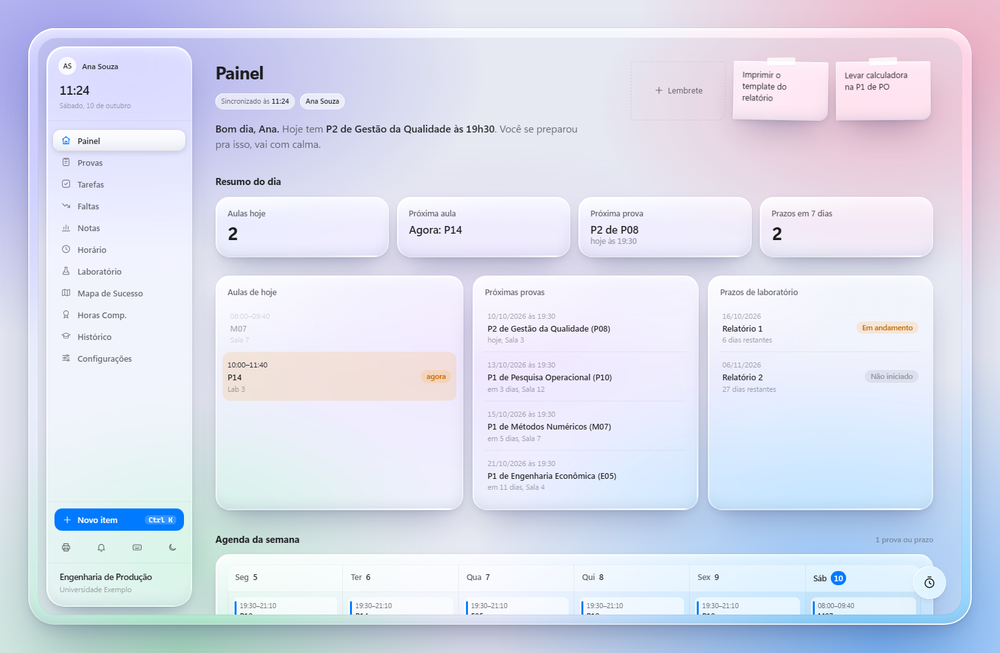

<div align="center">


Funciona no computador e no celular, offline, com os mesmos dados nos dois.

<a href="https://tulioh4.github.io/centro-de-controle/"></a>

[Instalar](#instalar) &nbsp;&nbsp; [Funcionalidades](#funcionalidades) &nbsp;&nbsp; [Seus dados](#seus-dados) &nbsp;&nbsp; [Como funciona](#como-funciona)

<br>



<sub>Captura com um perfil fictício.</sub>

</div>

---

## Instalar

O Centro de Controle é um **PWA**: abre no navegador e pode ser instalado como app, com ícone e janela próprios, sem loja.

| Aparelho | Como instalar |
|---|---|
| **Windows** (Edge ou Chrome) | Abra o [link do app](https://tulioh4.github.io/centro-de-controle/) e clique no ícone de instalar na barra de endereço, ou no botão de download na barra lateral do app. |
| **Android** (Chrome) | Abra o link, toque em **⋮** e depois em **Instalar app**. |

Depois de instalado, entre com a sua conta para ter os mesmos dados em todos os aparelhos, ou escolha **Usar sem conta** para guardar tudo só naquele aparelho.

Atualizações chegam sozinhas: a cada nova versão publicada, o app instalado se atualiza na próxima vez que for aberto com internet.

## Funcionalidades

**Painel**
- Um recado curto do dia: provas de hoje e amanhã, tarefas atrasadas ou vencendo e relatórios perto do prazo
- Resumo do dia: aulas, próxima aula, próxima prova e prazos da semana
- Próximas provas com data, horário e sala; prazos de laboratório em aberto
- Agenda da semana em grade, juntando aulas, provas, entregas e tarefas (no dia de uma prova, a aula da disciplina dá lugar a ela)
- Post-its de lembrete fixados no topo
- Linha do tempo de provas e plano de estudos sugerido para os próximos 7 dias

**Acompanhamento acadêmico**
- **Notas:** notas parciais com peso, meta por disciplina, calculadora de quanto falta na prova final, simulador de IRA e gráficos de desempenho
- **Faltas:** contador com limite editável por disciplina, aviso quando chega perto do limite e ranking de risco
- **Histórico** do curso inteiro, com busca, filtros e edição
- **Mapa de Sucesso:** o currículo organizado semestre a semestre
- **Horas complementares** e **Laboratório** (turmas e entrega de relatórios)

**Organização**
- Tarefas em lista ou em quadro kanban, com prioridade, categoria, filtros e conclusão com um toque
- Calendário de provas: tocar num dia já abre o formulário com a data
- Grade de horário semanal (no celular, um dia por vez, começando por hoje)
- Timer Pomodoro com registro de sessões de estudo por disciplina, que segue contando com a tela bloqueada ou o app fechado

**Do jeito de um app**
- Funciona offline e sincroniza quando a internet volta
- `Ctrl K` adiciona tarefa ou prova de qualquer tela; teclas `1` a `9` trocam de aba; `?` mostra os atalhos
- Atalhos no ícone (clique direito no Windows, toque longo no Android): nova tarefa, provas, tarefas
- Notificações de provas e prazos do dia e do dia seguinte
- Tema claro e escuro, no estilo *Liquid Glass*
- Assistente de configuração para novos usuários: a grade de Engenharia de Produção do INATEL é montada com toques (escolha o semestre e ajuste as disciplinas); outros cursos importam via Excel ou texto
- Backup em arquivo e, sem conta, vários perfis no mesmo aparelho

## Seus dados

- **Com conta:** os dados ficam na sua conta (Supabase), protegidos por regras que só permitem a cada usuário ler e gravar os próprios registros. O app trabalha sempre com uma cópia local, então abre na hora e funciona sem internet; as alterações sobem em segundo plano e aparecem nos outros aparelhos em poucos segundos.
- **Cada pessoa, sua conta:** para outra pessoa usar o app no mesmo aparelho, basta sair e entrar com a conta dela.
- **Sem conta:** tudo fica só no navegador daquele aparelho.
- **Backup:** em *Configurações → Backup dos dados*, exporte ou importe um arquivo `.json` com tudo do perfil.
- Este repositório é público, mas **não contém dados de ninguém**. A versão publicada leva apenas um modelo vazio (`dados_curso.template.js`), e o build é interrompido se encontrar dados pessoais no pacote.

## Como funciona

| Parte | Tecnologia |
|---|---|
| Interface | HTML, CSS e JavaScript puros, num único `index.html`, sem framework nem etapa de build no desenvolvimento |
| Gráficos | [Chart.js](https://www.chartjs.org/), carregado só quando a aba Notas abre |
| App instalável e offline | Web App Manifest + Service Worker (`sw.js`) |
| Conta e sincronização | [Supabase](https://supabase.com/) (Auth + Postgres + Realtime), em `sync.js` |
| Publicação | GitHub Pages via GitHub Actions |

**Sincronização em resumo:** cada gravação local é marcada com horário e enviada para a tabela `kv` (uma linha por item). Ao abrir o app, ao voltar para ele e em tempo real, as alterações mais novas de outros aparelhos são aplicadas; ao voltar para o app, ele confere primeiro só os horários e baixa apenas os itens que mudaram. Em caso de conflito, vale a alteração mais recente de cada item.

## Desenvolvimento

Rodar localmente (o service worker exige `http://`, não `file://`):

```bash
python -m http.server 8731
```

Depois, abra `http://localhost:8731`. O `index.html` também abre direto com duplo clique, só sem o modo offline do PWA.

Gerar a versão de publicação em `dist/`:

```bash
node scripts/build-pwa.mjs
```

O build copia o app, troca os dados pelo modelo vazio e carimba o service worker com uma versão nova. Ao enviar para a branch `main`, o GitHub Actions faz o build e publica no GitHub Pages.

Para usar um projeto Supabase próprio, rode [`supabase/schema.sql`](supabase/schema.sql) no SQL Editor e troque a URL e a chave pública no início de [`sync.js`](sync.js).

### Estrutura

```
index.html                 o app inteiro (interface, estilos e lógica)
sync.js                    login e sincronização com o Supabase
sw.js                      service worker: cache e funcionamento offline
manifest.webmanifest       nome, ícones e atalhos do app instalado
dados_curso.template.js    modelo de dados vazio usado na publicação
icons/                     ícones do app
scripts/build-pwa.mjs      gera dist/ para publicar
supabase/schema.sql        tabela e regras de acesso
.github/workflows/         publicação automática no GitHub Pages
```
